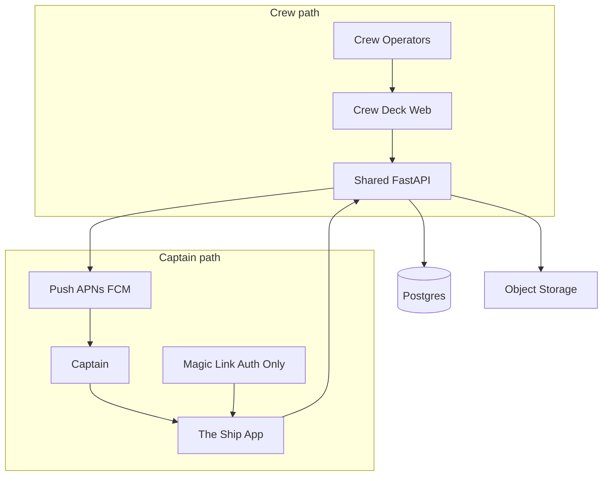
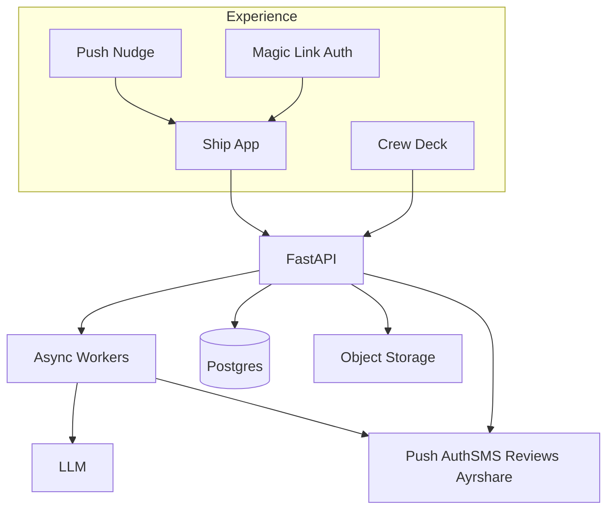
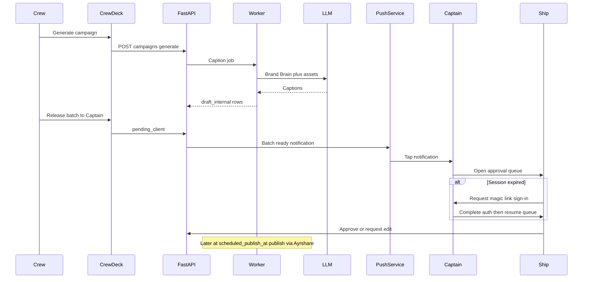
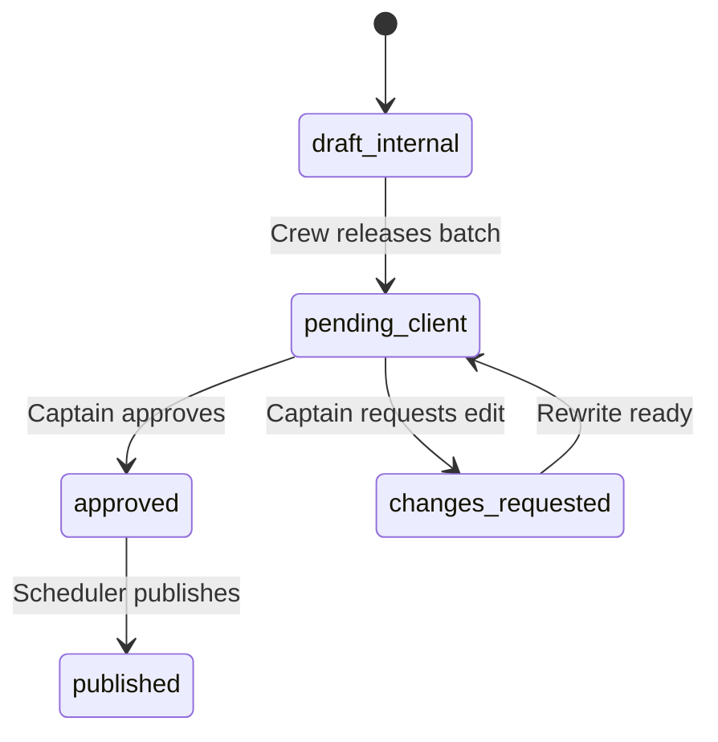

# A-hoy Marketing Platform — Technical Implementation Plan

**Document Version:** 1.4  
**Status:** Initial plan (push-primary nudges; magic link for auth only)  
**Build progress:** Milestone A implemented — see [milestone_a.md](./milestone_a.md) (living build log).  
**Source inputs:** [`business docs/a_hoy_product_requirements_document_prd.md`](../business%20docs/a_hoy_product_requirements_document_prd.md), [`business docs/a_hoy_strategy_hybrid_playbook.md`](../business%20docs/a_hoy_strategy_hybrid_playbook.md), [`a_hoy_postgresql_database_schema.sql`](../a_hoy_postgresql_database_schema.sql)

---

## Verdict

Build a **Phase 1 Concierge MVP** first (5–10 pilot clients) around this product metaphor:

| Metaphor | Who / what | Surface |
|---|---|---|
| **Captain** | The business owner (SMB client) | Commands the business; monitors ROI and approves work |
| **Crew** | A-hoy marketers / operators (and field shooters later) | Runs marketing solutions day to day |
| **Ship** | The client mobile app | Where the Captain steers: Treasure Map, approvals, reviews |

The **Ship** (Capacitor iOS/Android app) is the primary customer product. The **Crew Deck** is a **web** workspace for internal operators. AI copy/reviews are assisted; full media slicing waits for Phase 2. The repo already defines the data model in [`a_hoy_postgresql_database_schema.sql`](../a_hoy_postgresql_database_schema.sql); treat that as the source of truth and extend it where MVP gaps appear.

> **PRD naming note:** The PRD calls the agency user “Account Captain” and the client portal “The Bridge.” This plan **supersedes that language** for product/UX: **Captain = owner**, **Crew = agency**, **Ship = app**. Feature IDs (`CL-*`, `AG-*`) stay as traceability tags only.

**Defaults locked for this plan:**
- **Ship (Captain):** Capacitor wraps the Next.js Ship UI into App Store / Play Store apps.
- **Nudges:** **Push notifications are primary** (“batch ready”, “review needs you”). Tapping a push deep-links into the Ship screen.
- **Auth:** **Magic link / OTP SMS is for sign-in only** (first login, reinstall, expired session) — not the everyday “content is ready” channel. If a push is tapped with no valid session, the Ship prompts magic-link login, then routes to the intended screen.
- **SMS fallback:** Only if push is unavailable (permission denied / no device token) send a plain SMS that opens the Ship (or magic-link login if needed).
- **Crew Deck:** Web-only admin (`/crew`) — not a mobile app.
- **Cloud:** Supabase (Postgres + Auth + Storage) + Vercel (Next.js) + background workers on Railway/Fly for FastAPI jobs.
- **Scope:** Phase 1 build order; Phase 2/3 as extension seams only.

---

## Product → System Map

A-hoy is one product: the **Captain** uses the **Ship**; the **Crew** works the **Crew Deck**. Both talk to the same API, database, and media store.

### 1. Metaphor → surfaces

| Face | Who uses it | Job in one sentence | Surface |
|---|---|---|---|
| **The Ship** | Captain (business owner) | See ROI, approve posts, handle bad reviews — in minutes, usually from a **push** | **Mobile app** (Capacitor → iOS/Android); mobile web fallback |
| **Crew Deck** | Crew (A-hoy operators) | Maintain Brand Brain, assemble campaigns, push batches to the Captain, fix revisions | **Web admin** only (`/crew`) |

Field shooters are **Crew (deckhands)** but **not in Phase 1** — shoot list + upload lands in Phase 2 on Crew Deck APIs.

Two separate paths into the same backend (drawn as chains so arrows do not cross):



### 2. System layers (what the boxes mean)

Read top → bottom. Each layer feeds the next; side integrations hang off Application / Workers only.

| Layer | Components | Responsibility |
|---|---|---|
| **Experience** | **Ship** (Capacitor app), **Crew Deck** (web), push deep links, magic-link auth | UI and auth entry; no business logic beyond form validation |
| **Application** | FastAPI HTTP routes | Auth, tenancy (`client_id` scope), CRUD, status transitions (approve / request edit / push batch) |
| **Workers** | Async job runners (Redis-backed) | Slow or external work: LLM captions, review replies, scheduled publish, nightly ROI rollups, **send push** |
| **Intelligence** | OpenAI / Claude (+ Whisper later) | Copy, review drafts, Brand Brain embeddings — always prompted with that client’s brand profile |
| **Data** | Postgres + `pgvector`, object storage | Source of truth for clients, queue, ROI, reviews, **device push tokens**; binaries in blob storage |
| **Integrations** | APNs/FCM, Twilio, review APIs, Ayrshare, Stripe | Push nudges, auth SMS, call tracking, publish, billing |



### 3. Who does what in Phase 1 MVP

| Persona (theme) | PRD trace | Primary surface | Features they touch | Feature IDs |
|---|---|---|---|---|
| **Captain** (business owner) | Time-Poor Owner | **The Ship** (iOS/Android) | Treasure Map ROI, approval queue, reputation radar, **push** → Ship; magic link only to sign in | `CL-01`, `CL-02`, `CL-05` |
| **Crew** (operator) | Account Captain | **Crew Deck** (web) | Brand Brain editor, campaign draft generation, push batch to Captain, revision triage | `AG-01`, `AG-03` |
| **Crew (deckhand)** | Field Creator | — (Phase 2) | Shoot booking, AI shot list, raw upload to vault | `CL-03`, `AG-02`, `AG-04` |

### 4. Core business flow (content batch) — how the layers connect

This is the main loop the MVP must nail.

1. **Crew** uploads or selects media and runs **Generate campaign** (Crew Deck → API → Worker → LLM + Brand Brain).
2. New rows land in `content_queue` as `draft_internal`; Crew reviews and **pushes batch** to the Captain.
3. Status becomes `pending_client`; worker sends a **push** (“Your crew has posts ready”) with a deep link to the approval queue. If no push token / permission, fall back to a plain SMS open-link.
4. **Captain** taps the push → **Ship** opens the queue. If the session is expired, Ship requests **magic-link auth**, then continues to the same queue screen.
5. Captain approves / requests edit / swaps media.
6. Approved items wait until `scheduled_publish_at`; a worker publishes via Ayrshare and marks `published`.
7. Separately, Twilio call/form events and review feeds feed the Treasure Map and Reputation Radar; low-star reviews also trigger a **push** (SMS fallback if needed).



### 5. How data is owned (mental model)

| Concern | Primary tables / stores | Written by | Read by |
|---|---|---|---|
| Who the client is + tier | `clients`, `users` | Crew / admin | Ship + Crew Deck, billing |
| Brand voice for AI | `brand_profiles` (+ embedding) | Crew | Workers / LLM prompts |
| Photos and clips | `media_assets` + blob URLs | Crew (Phase 1); deckhand later | Ship vault, queue cards |
| Posts awaiting action | `content_queue` | Generator + Crew + Captain actions | Ship queue, Crew calendar |
| Device push tokens | `device_push_tokens` (MVP add) | Ship on login / permission grant | Push worker |
| Instant promos | `flare_requests` | Captain (Phase 2) | Crew / workers |
| ROI numbers | `daily_roi_metrics`, `lead_events` | Twilio webhooks + nightly rollup | Ship Treasure Map |
| Reviews | `reviews` (MVP add) | Ingest workers | Ship Reputation Radar |

### 6. What is deliberately not on this map yet

Phase 1 wires: **auth → Brand Brain → draft/approve → publish**, plus **ROI + reviews**. Schema seams stay stubs until Phase 2/3:

- Flare Gun instant promos (`CL-04` / `flare_requests`) — Captain fires from the Ship
- On-site shoot scheduler and AI shot lists (`CL-03` / `AG-04` / `shoots`)
- Full AI media multiplier (FFmpeg / Whisper slicing) (`AG-02`)
- POS revenue attribution and auto ad launch (Phase 3)

---

## Recommended Stack (aligned with PRD §4)

| Layer | Choice | Why |
|---|---|---|
| Ship (Captain app) | **Capacitor** shell around Next.js Ship UI (iOS + Android) | Home-screen install, store distribution, push + deep links |
| Web frontend | Next.js 15 App Router, TypeScript, Tailwind | Ship routes (wrapped by Capacitor) + Crew Deck `/crew` |
| API | Python FastAPI | Matches PRD; good for media/LLM workers later |
| DB | PostgreSQL + `pgvector` (schema already drafted) | Brand Brain RAG + relational ops |
| Auth | Magic-link / OTP via Twilio SMS (**sign-in only**) | Passwordless Captains; Crew uses email/password or magic link on Crew Deck |
| Push | Capacitor Push + APNs / FCM | Primary nudge channel for batch ready and review alerts |
| Storage | Supabase Storage or S3-compatible bucket | Media vault URLs already on `media_assets` |
| AI text | OpenAI GPT-4o or Claude for captions + review replies | Inject `brand_profiles` into every prompt |
| Comms | Twilio for auth SMS, call tracking, and push-unavailable fallback SMS | Not the primary “batch ready” channel |
| Publish | Ayrshare first (Meta/TikTok/GBP later as needed) | One API for omnichannel in MVP |
| Billing | Stripe Billing (Harbor / Cruiser / Flagship) | Tier enum already in schema |
| Jobs | Celery/RQ or FastAPI + Redis for async | Captions, publish, push send, ROI rollups |

**Repo layout (greenfield):**

```text
/
  apps/web/          # Next.js: Ship (Captain) routes + Crew Deck (/crew)
  apps/mobile/       # Capacitor project wrapping the Ship; iOS/Android targets
  apps/api/          # FastAPI
  packages/db/       # migrations from a_hoy_postgresql_database_schema.sql
  business docs/     # existing PRD + playbook
  docs/              # architecture ADRs, runbooks
```

**Ship packaging note:** Ship UI is designed mobile-first in `apps/web`. Capacitor in `apps/mobile` loads that UI, registers push (APNs/FCM), and handles notification deep links. Universal/app links remain for magic-link auth and SMS fallback.

---

## Data Model: Use Existing Schema, Add MVP Gaps

Keep tables from [`a_hoy_postgresql_database_schema.sql`](../a_hoy_postgresql_database_schema.sql):
`users`, `clients`, `brand_profiles`, `shoots`, `media_assets`, `content_queue`, `flare_requests`, `daily_roi_metrics`.

**Role rename (align schema with theme):**
- PRD/schema today: `client_owner`, `account_captain`, `field_creator`
- Plan going forward: `captain`, `crew`, `deckhand` (migrate enum + `clients.assigned_captain_id` → `assigned_crew_id`)

**Add for Phase 1 (migration):**
- `auth_magic_links` / session table: token hash, `user_id`, expires_at (48h JWT as in Epic 1.1) — **auth only**
- `device_push_tokens`: `user_id`, platform (`ios`|`android`), token, last_seen_at, enabled
- `reviews`: provider, external_id, rating, body, `ai_reply`, `reply_status` (`auto_sent` | `awaiting_captain` | `captain_approved` | `skipped`), `client_id`
- `integration_credentials`: encrypted OAuth tokens per client (GBP, Meta, Yelp, Stripe connect later)
- `lead_events`: call/form events feeding `daily_roi_metrics` (Twilio webhooks, form posts)
- Optional `content_queue.voice_feedback_url` for edit voice notes

Indexes already cover the hot paths (`content_queue` by client+status; ROI by date). Index `device_push_tokens(user_id)` for send.

---

## Phase 1 Build Order (Months 1–2)

### Milestone A — Foundation (week 1–2) — **DONE**
1. Scaffold monorepo (`apps/web`, `apps/api`, `apps/mobile` Capacitor shell), CI, env templates.
2. Apply schema + MVP gap migrations (including `captain` / `crew` / `deckhand` roles + `device_push_tokens`); seed 1 demo client (e.g. Oak Lawn Optometry).
3. Auth: Twilio SMS magic link / OTP → short-lived JWT → **Ship** session (**sign-in only**); role gates (`captain` vs `crew`).
4. Multi-tenant middleware: every query scoped by `client_id`.
5. Register for push on Ship install/login; store tokens; configure notification deep links (and universal links for auth / SMS fallback).

Details and runbook: [milestone_a.md](./milestone_a.md).

### Milestone B — Crew Deck core (`AG-01`, `AG-03`) (week 2–3) — **DONE** (local)
1. Brand Brain CRUD: voice, services JSON, zips, compliance; embed into `context_embedding` on save.
2. Semi-automated campaign generator: Crew uploads/selects assets → API calls LLM with Brand Brain → writes `content_queue` as `draft_internal` → Crew reviews → `pending_client` → **push** to Captain (SMS fallback if no token).
3. Revision loop: Captain `changes_requested` + feedback → LLM rewrite or Crew flag (Epic 1.2).

Details: [milestone_b.md](./milestone_b.md).

### Milestone C — The Ship (`CL-01`, `CL-02`, `CL-05`) (week 3–5) — **DONE** (local)
1. **Treasure Map:** aggregate `daily_roi_metrics`; estimated revenue formula from PRD when POS absent; detail drawer for calls/forms.
2. **Approval queue:** card/grid UI matching wireframe; Approve / Request Edit / Swap Media; optimistic UI (<200ms feel); Approve All; open from push deep link.
3. **Reputation Radar:** ingest reviews (start with Google Business Profile); auto-reply 4–5★ with optional delay; **push** + one-click approve for 1–3★ (SMS fallback if needed).
4. Bottom nav: Home, Calendar (stub), Media Vault (read-only list), Reviews.
5. Ship TestFlight / internal Play track builds for pilot Captains (store listing can stay private/unlisted) — Capacitor sync notes in milestone_c; store submit deferred.

Details: [milestone_c.md](./milestone_c.md).

### Milestone D — Pilot hardening (week 5–8)
1. Stripe subscription ↔ `subscription_tier`.
2. Ayrshare publish job for `approved` posts at `scheduled_publish_at`.
3. Twilio call tracking → `lead_events` → nightly rollup into `daily_roi_metrics`.
4. Observability: structured logs, Sentry (web + Capacitor), push delivery metrics, basic admin audit of status transitions.
5. Pilot with 5–10 local SMBs on the **installed Ship**; measure KPIs from PRD §7 (time-to-approve, push open rate / app interaction rate).

**Explicitly out of Phase 1 code path (stubs only):** Flare Gun (`CL-04`), shoot booking (`CL-03`), FFmpeg/Whisper media multiplier (`AG-02`), POS attribution, automated ad launch.

---

## Key API Surface (FastAPI)

- `POST /auth/magic-link` · `GET /auth/verify` (Captain sign-in)
- `POST /devices/push-token` · `DELETE /devices/push-token`
- `GET /clients/{id}/roi` · `GET /clients/{id}/roi/breakdown`
- `GET /clients/{id}/queue` · `POST /queue/{post_id}/approve` · `POST /queue/{post_id}/request-edit` · `POST /queue/{post_id}/swap-asset`
- `GET/POST /clients/{id}/brand-profile`
- `POST /clients/{id}/campaigns/generate` (Crew)
- `GET /clients/{id}/reviews` · `POST /reviews/{id}/approve-reply`
- Webhooks: `POST /webhooks/twilio/sms` · `POST /webhooks/twilio/voice` · `POST /webhooks/ayrshare`

Status machine for content:



---

## Frontend Information Architecture

**The Ship (Captain app):** mobile-first UI per wireframe in PRD §5 — Treasure Map, approval stack, compact shoot stub + reputation summary. Capacitor packages this as the A-hoy app. Copy speaks to the Captain (“Your crew has posts ready for inspection”). **Push** opens the relevant queue item or review; magic link is only the sign-in gate when needed. Flare Gun is Phase-2 gated.

**Crew Deck (web only):** `/crew` routes — client list, Brand Brain editor, media vault upload, draft calendar, push batch, flagged revisions. Operational density is fine; Crew are not the Ship audience.

**Fallback:** same Ship routes remain reachable in mobile Safari/Chrome if the app is not installed, so pilots are never blocked on store approval.

---

## AI / Prompt Architecture

- Central `BrandContext` loader: `brand_profiles` row + top-k similar chunks if docs grow; always inject compliance rules.
- Prompt templates versioned in `apps/api/prompts/`: `caption_batch`, `review_reply_positive`, `review_reply_negative`, `revision_from_feedback`.
- Store model, prompt version, and raw completion metadata on generated rows (add `generation_meta JSONB` on `content_queue` / `reviews`) for audit in regulated niches (optometry/dental).

---

## Security & Tenancy

- RLS (Supabase) or strict API-side `client_id` checks for every resource.
- Encrypted integration tokens; no secrets in the Ship client bundle.
- Magic links single-use or short TTL (48h); phone ownership verified via Twilio (Captain **auth only**).
- Push tokens bound to `user_id`; revoke on logout.
- Healthcare-adjacent clients: compliance text enforced in prompts; avoid PHI in logs or push payloads (deep link IDs only, not review body text).

---

## Phase 2 / 3 Extension Seams (do not build yet)

| Phase | Features | Technical hooks prepared in MVP |
|---|---|---|
| 2 | `AG-02` media pipeline, `CL-04` Flare Gun (Captain), `CL-03` shoots (Crew deckhand) | `media_assets` + worker queue; `flare_requests`; `shoots` |
| 3 | POS attribution, auto ads | `pos_provider`, `pos_attributed_revenue_usd`; ad spend on ROI |

Media pipeline later: upload → FFmpeg extract → Whisper → vertical slice → Vision tags → campaign generator (Epic 3.1).

---

## Success Criteria for MVP

- Pilot **Captains** use the **installed Ship** as their primary surface; **push** is how they learn a batch or review needs them.
- Captain approves a full monthly batch in under 3 minutes from push → Ship (magic link only if re-auth required).
- Estimated revenue card matches PRD formula with transparent breakdown.
- 4–5★ reviews auto-replied with Brand Brain voice; low-star alerts via **push** (SMS only as fallback).
- **Crew** fulfillment path for a client batch under ~60 minutes on Crew Deck without full media AI yet.
- Schema + APIs ready to drop in Flare Gun and media workers without redesign.

---

## Implementation Checklist

1. Scaffold `apps/web` (Next.js) + `apps/mobile` (Capacitor Ship) + `apps/api` (FastAPI), CI, env templates
2. Apply Postgres schema + MVP gaps; rename roles to `captain` / `crew` / `deckhand`; add `device_push_tokens`
3. Magic-link / OTP auth (sign-in only), push registration + deep links, `client_id`-scoped middleware/RLS
4. Brand Brain CRUD + embedding + semi-automated campaign generator on Crew Deck
5. Ship: Treasure Map, approval queue, revision loop opened from push
6. Review ingest, AI replies, push alerts for low ratings (SMS fallback)
7. TestFlight / internal Play builds for pilot Captains
8. Ayrshare scheduler, Stripe tiers, Twilio call rollups, pilot instrumentation

---

## Immediate Next Implementation Steps (after plan approval)

1. Initialize monorepo (`web` + `mobile` + `api`) and apply/extend SQL migrations (including role rename + push tokens).
2. Implement auth (magic link) + push token registration + tenant middleware.
3. Ship Brand Brain + draft → pending → **push** → Captain approve loop end-to-end on a device build.
4. Add Treasure Map + Reputation Radar; wire Twilio call tracking + review ingest.
5. Soft-launch pilots on TestFlight / internal Play; instrument push open rate and time-to-approve.
